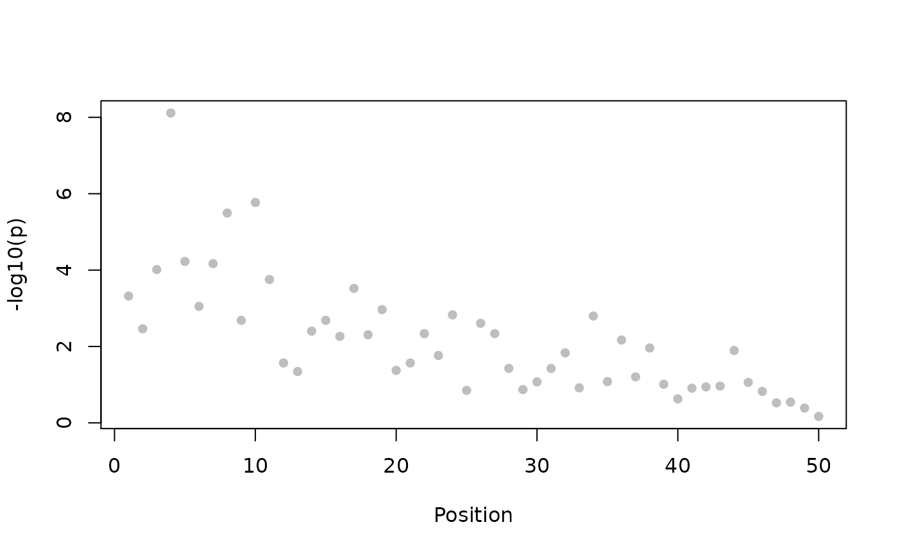
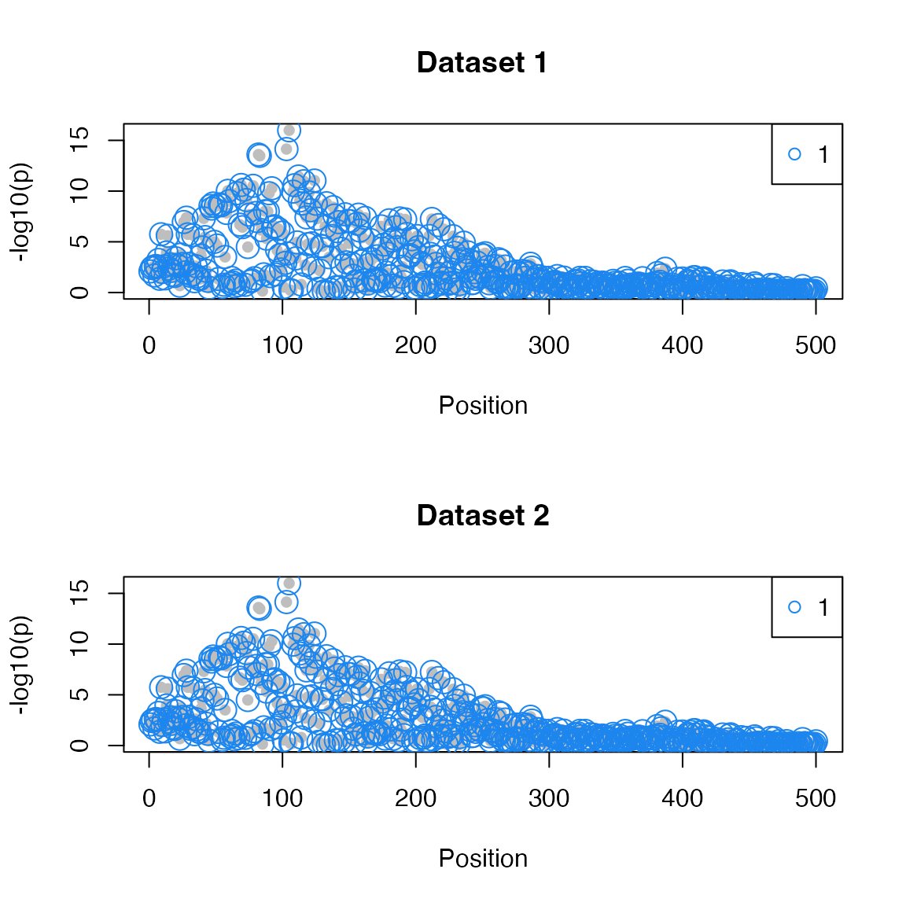
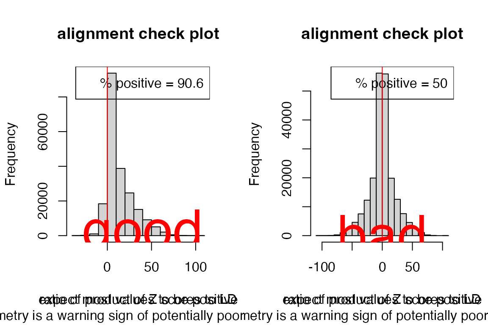

# Coloc: data structures

## Data structures

The enumeration approaches to coloc
[`coloc.abf`](https://chr1swallace.github.io/coloc/articles/a03_enumeration.md)
and
[`coloc.susie`](https://chr1swallace.github.io/coloc/articles/a06_SuSiE.md)
require the same data format. To be flexible, `coloc.abf` allows a wider
variety of inputs, which can sometimes be confusing. This document aims
to set out what ideal and acceptable data structures are, as well as
covering some points on how you should select the SNPs for study.

### First: select the SNPs to study.

Each dataset must represent the genetic association statistics for *a
single trait* in *a single genomic region*. This means you should not,
for example,

- supply coloc with a whole genome or whole chromosome of test
  statistics
- merge eQTL summary stats across multiple genes

SNPs must

- have summary data available in both studies
- cover a single genomic region (perhaps defined by distance about some
  GWAS peak or delimited by recombination hotspots), and
- represent a dense coverage of the region (so don’t threshold on p
  value)

This can result in up to 10,000 SNPs on larger regions. A single genomic
region *does not* correspond to the whole genome, nor to a whole
chromosome. Coloc also does not automatically split chromosomes or a
genome into regions. It is assumed the user can look at their data,
identify a region with overlapping GWAS signals between two studies, and
decide on the set of SNPs to include. Some utilities are provided which
can help check regions are sensible.

Please do include all SNPs you have in the region: do not trim by
significance or MAF or other means. Coloc enumerates all possible
configureations of shared and non-shared causal variants and evaluates
their relative support; it cannot do this if it does not have all the
SNPs available.

### A minimum coloc dataset

Colocalisation and fine-mapping work through evaluating approximate
Bayes factors summarising evidence for association at each SNP. This
requires knowing the estimated effect size $`\beta`$ (`beta`) and its
uncertainty $`var(\beta)`$ (`varbeta`). $`var(\beta)`$ is the standard
error of $`\beta`$, squared. It is also good practice to supply SNP
names (`snp`), and SNP positions (`position`) are useful if you want to
use coloc’s
[`plot_dataset()`](https://chr1swallace.github.io/coloc/reference/plot_dataset.md).

We also need a prior on the true effect sizes at causal variants, which
is different depending on whether you have a quantitative or
case-control (binary) trait. To estimate a prior, we need to know the
trait standard deviation (which allows us to interpret the scale of the
estimated beta).

A minimum coloc dataset is a **list**, containing a mix of vectors
(values that vary across snps, such as effect sizes `beta` or variance
of beta `varbeta`) and scalars (values assumed to be constant across
snps, such as sample size \[`N`\] or data type \[`type="cc"` for case
control or `type="quant"` for quantitative\]). See
[`?check_dataset`](https://chr1swallace.github.io/coloc/reference/check_dataset.md)
for the full set of entries, some combination of which are compulsory.

It can be useful to run
[`check_dataset()`](https://chr1swallace.github.io/coloc/reference/check_dataset.md)
on each of your datasets if coloc functions aren’t running. It will
return NULL if it finds no errors. It will stop with error if there are
issues that absolutely must be fixed to run coloc, but may print
warnings if it sees something merely suspicious - eg if there is no
strong signal of association.

Coloc comes with test data, so you can explore the structure for a
quantitative trait. Here we show the minimum dataset needed for a
quantitative trait.

``` r

library(coloc)
```

    ## This is coloc version 7.0.2

``` r

data(coloc_test_data)
attach(coloc_test_data)
minimum_data=D1[c("beta","varbeta","snp","position","type","sdY")]
str(minimum_data)
```

    ## List of 6
    ##  $ beta    : num [1:500] 0.337 0.211 0.257 0.267 0.247 ...
    ##  $ varbeta : num [1:500] 0.01634 0.00532 0.00748 0.01339 0.00664 ...
    ##  $ snp     : chr [1:500] "s1" "s2" "s3" "s4" ...
    ##  $ position: int [1:500] 1 2 3 4 5 6 7 8 9 10 ...
    ##  $ type    : chr "quant"
    ##  $ sdY     : num 1.1

``` r

check_dataset(minimum_data,warn.minp=1e-10)
```

    ## NULL

Here we see (from `str`) that `minimum_data` is a list. It has vector
entries beta, varbeta, snp and position, all of the same length (the
number of snps in the region) and scalar entries for type and sdY (the
standard deviation of the quantitative trait).

[`check_dataset()`](https://chr1swallace.github.io/coloc/reference/check_dataset.md)
issues a **warning** that the minimum p value exceeds `warn.minp`. (The
default value for `warn.minp` is 10^{-6}). The warning doesn’t mean you
can’t run coloc - it is perfectly valid to assess that there is only
evidence for association in one of your datasets, but it may alert you
to check something if you *thought* there was strong association there.
One common mistake is to use the standard error of beta in place of the
variance of beta. If your dataset provides the standard error, simply
square it to get the variance.

It’s also useful to plot your datasets, and check

- coverage is dense
- the level of association matches your expectation

``` r

plot_dataset(minimum_data)
```



For a case control trait, you would need to give the `type` as “cc”:

``` r

minimum_ccdata=D1[c("beta","varbeta","snp","position")]
minimum_ccdata$type="cc"
str(minimum_ccdata)
```

    ## List of 5
    ##  $ beta    : num [1:500] 0.337 0.211 0.257 0.267 0.247 ...
    ##  $ varbeta : num [1:500] 0.01634 0.00532 0.00748 0.01339 0.00664 ...
    ##  $ snp     : chr [1:500] "s1" "s2" "s3" "s4" ...
    ##  $ position: int [1:500] 1 2 3 4 5 6 7 8 9 10 ...
    ##  $ type    : chr "cc"

``` r

check_dataset(minimum_ccdata)
```

    ## NULL

In either case, you can see that the lengths of beta, varbeta, snp and
position are the same. They are assumed to represent the same snps in
the same order. If you have your data in a data.frame, you could use
[`as.list()`](https://rdrr.io/r/base/list.html) to convert to a list,
and then add the other elements, but you cannot pass a data.frame to
coloc, because elements like `type` need to be of length 1.

### Analysing two datasets

coloc is used to analyse exactly two datasets. The snp identifiers are
used to match snps between datasets, and only the snps that appear in
both datasets will contribute to the analysis.

It is useful to plot the pair of datasets, and check that the shared
snps cover any peaks in either dataset.

``` r

plot_datasets(minimum_data, minimum_ccdata)
```



Here they will all be shared because they are copies of the same
dataset. But any snps not coloured blue would be unique to one dataset
or the other.

``` r

short_data1=lapply(D1[c("beta","varbeta","snp","position")], "[", 200:500)
short_data2=lapply(D1[c("beta","varbeta","snp","position")], "[", 1:400)
short_data1$type="cc"
short_data2$type="cc"
check_dataset(short_data1)
```

    ## NULL

``` r

check_dataset(short_data2)
```

    ## NULL

``` r

plot_datasets(short_data1, short_data2)
```


### What if I don’t have sdY?

Often, sdY is not available for quantitative datasets. If the study say
they standardised their trait to have variance 1, then you can set =sdY=
to 1. Otherwise coloc can estimate it, but needs MAF and sample size
information too. So the dataset would look like:

``` r

nosdY_data=D1[c("beta","varbeta","snp","position","type","N","MAF")]
str(nosdY_data)
```

    ## List of 7
    ##  $ beta    : num [1:500] 0.337 0.211 0.257 0.267 0.247 ...
    ##  $ varbeta : num [1:500] 0.01634 0.00532 0.00748 0.01339 0.00664 ...
    ##  $ snp     : chr [1:500] "s1" "s2" "s3" "s4" ...
    ##  $ position: int [1:500] 1 2 3 4 5 6 7 8 9 10 ...
    ##  $ type    : chr "quant"
    ##  $ N       : int 1000
    ##  $ MAF     : num [1:500] 0.031 0.166 0.0925 0.0405 0.118 ...

``` r

check_dataset(nosdY_data)
```

    ## NULL

### What if I don’t have beta and/or varbeta?

beta and varbeta are preferred. Please supply them if you have them,
especially in the case of imputed data where they capture the effects of
imperfect imputation. But if you don’t have them, coloc can estimate
them, given p values, MAF, sample size and, if case-control data, the
fraction of samples that are cases:

``` r

nobeta_data=D1[c("MAF","snp","position","type","sdY","N")]
nobeta_data$pvalues=pnorm(-abs(D1$beta/sqrt(D1$varbeta)))*2
str(nobeta_data)
```

    ## List of 7
    ##  $ MAF     : num [1:500] 0.031 0.166 0.0925 0.0405 0.118 ...
    ##  $ snp     : chr [1:500] "s1" "s2" "s3" "s4" ...
    ##  $ position: int [1:500] 1 2 3 4 5 6 7 8 9 10 ...
    ##  $ type    : chr "quant"
    ##  $ sdY     : num 1.1
    ##  $ N       : int 1000
    ##  $ pvalues : num [1:500] 0.0083 0.00385 0.00294 0.02088 0.00242 ...

``` r

check_dataset(nobeta_data)
```

    ## NULL

``` r

nobeta_ccdata=D1[c("MAF","snp","position","N")]
nobeta_ccdata$pvalues=pnorm(-abs(D1$beta/sqrt(D1$varbeta)))*2
nobeta_ccdata$type="cc"
nobeta_ccdata$s=0.5
str(nobeta_ccdata)
```

    ## List of 7
    ##  $ MAF     : num [1:500] 0.031 0.166 0.0925 0.0405 0.118 ...
    ##  $ snp     : chr [1:500] "s1" "s2" "s3" "s4" ...
    ##  $ position: int [1:500] 1 2 3 4 5 6 7 8 9 10 ...
    ##  $ N       : int 1000
    ##  $ pvalues : num [1:500] 0.0083 0.00385 0.00294 0.02088 0.00242 ...
    ##  $ type    : chr "cc"
    ##  $ s       : num 0.5

``` r

check_dataset(nobeta_ccdata)
```

    ## NULL

Note that coloc doesn’t mind if your dataset has more entries than it
minimally needs, it will use what it needs, preferring supplied
beta/varbeta and sdY over estimation, and leave the rest.

### Additional LD information for `coloc.susie`

`coloc.abf` makes the simplifying assumption that each trait has at most
one causal variant in the region under consideration. This means it does
not need to know about correlation (LD) between SNPs, because no model
under consideration has two or more SNPs in it. `coloc.susie` extends
the functionality by allowing more than one causal variant, but this
means it needs to know the LD between the SNPs. You may be able to get
this from the study data, but if not, reference data such as 1000
Genomes can be used.

Our test data has an LD matrix already. This will be a square numeric
matrix of dimension equal to the number of SNPs, with dimnames
corresponding to the SNP ids.

``` r

str(D1$LD)
```

    ##  num [1:500, 1:500] 1 0.365 0.54 0.851 0.463 ...
    ##  - attr(*, "dimnames")=List of 2
    ##   ..$ : chr [1:500] "s1" "s2" "s3" "s4" ...
    ##   ..$ : chr [1:500] "s1" "s2" "s3" "s4" ...

#### NB studies from different populations

One of the nice things about `coloc.abf` is that it does not assume that
LD structures are similar between studies, as long as there is a dense
map of SNPs across the region. The same thing still applies to
`coloc.susie`, just add an appropriate LD matrix to each study.

#### NB allele order matters!

beta coefficients in GWAS studies report the effect of one allele with
respect to the other. That is, if you see results looking like

| CHR38 | BP38 | REF | ALT | SNPID | P | BETA | SE | maf | maf_cases | maf_controls |  |
|----|----|----|----|----|----|----|----|----|----|----|----|
| 1 | 2101817 | G | A | rs908742 | 0.0826 | 0.0749 | 0.0432 | 0.4394 | 0.456 | 0.4391 |  |
| 1 | 2109497 | T | C | rs4648808 | 0.8695 | -0.0144 | 0.0877 | 0.9347 | 0.9344 | 0.9347 |  |
| 1 | 2126584 | A | G | rs3128291 | 0.7334 | -0.0306 | 0.0897 | 0.939 | 0.9371 | 0.9391 |  |
| 1 | 2137467 | G | T | rs3128296 | 0.8802 | -0.0124 | 0.0826 | 0.9268 | 0.9267 | 0.9268 |  |
| 1 | 2139901 | C | A | rs424079 | 0.6399 | -0.0207 | 0.0442 | 0.6347 | 0.6269 | 0.6348 |  |

the beta is telling you about the effect of allele A compared to allele
G at the snp rs908742. If the alleles were reversed, beta would be
-0.0826. The LD matrix needs to be aligned the same way. This will be
easy if you have the GWAS data and are making the LD matrix yourself. If
you get it from a public source, it will almost certainly be telling you
about the LD between non-reference alleles. In this case, you need to
make sure your data is also listing the non-reference allele as the
“alternative” or “risk” allele. If it is not, switch the sign of beta.

To avoid hassles, I recommend: \* if using GWAS catalog data, download
the [*harmonised*
version](https://www.ebi.ac.uk/gwas/docs/methods/summary-statistics)
which will do this for you. \* if using eQTL summary data that has been
processed by the [eQTL
catalogue](https://www.ebi.ac.uk/gwas/docs/methods/summary-statistics),
use that version because it will also be harmonised \* Otherwise, check
the alleles in your summary table match those in the information files
from the LD source \* Finally, always plot the coloc result with the
[`sensitivity`
function](https://chr1swallace.github.io/coloc/articles/a04_sensitivity.md)
because weird effects are much easier to understand visually

You can also use the coloc function `check_alignment` as a visual guide.
It compares the product of the Z scores for all SNP pairs against their
correlation, and plots a histogram of this ratio for SNPs in some degree
of LD. We do not expect to see strongly negative products of Z scores
for strongly positive correlations or vice versa. Therefore this plot
*should be* skewed to have more positive values than negative. Here I
show a good (left) and bad (right) example.

``` r

par(mfrow=c(1,2))
check_alignment(goodD)
```

    ## [1] 0.9061496

``` r

text(40,200,"good",col="red",cex=4)
check_alignment(badD)
```

    ## [1] 0.4999569

``` r

text(0,200,"bad",col="red",cex=4)
```


