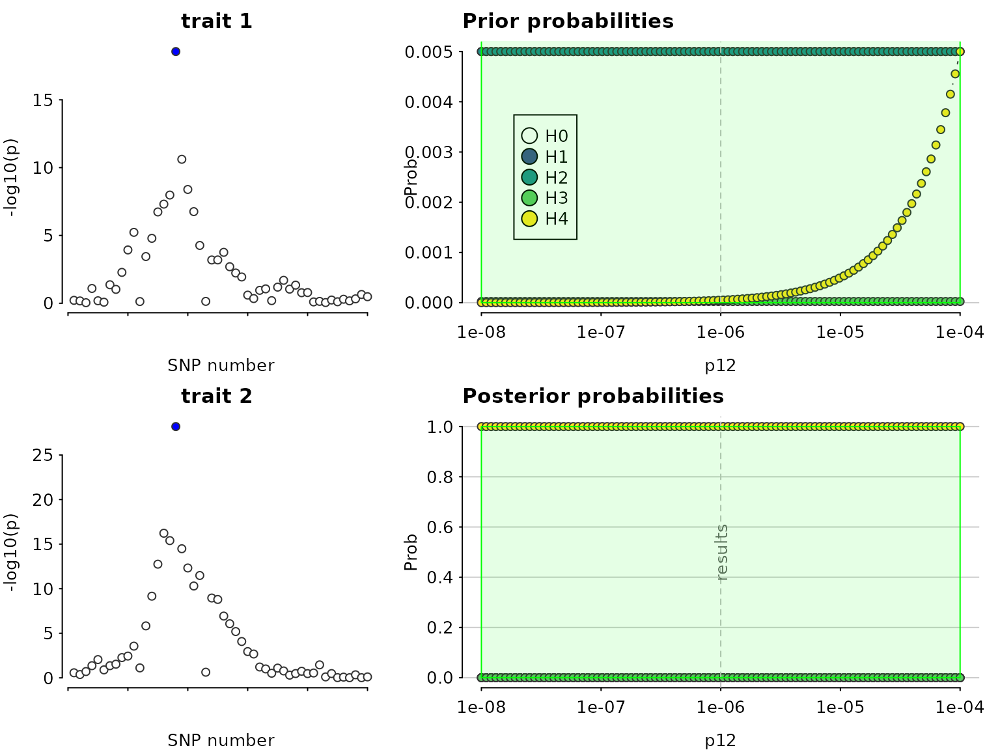
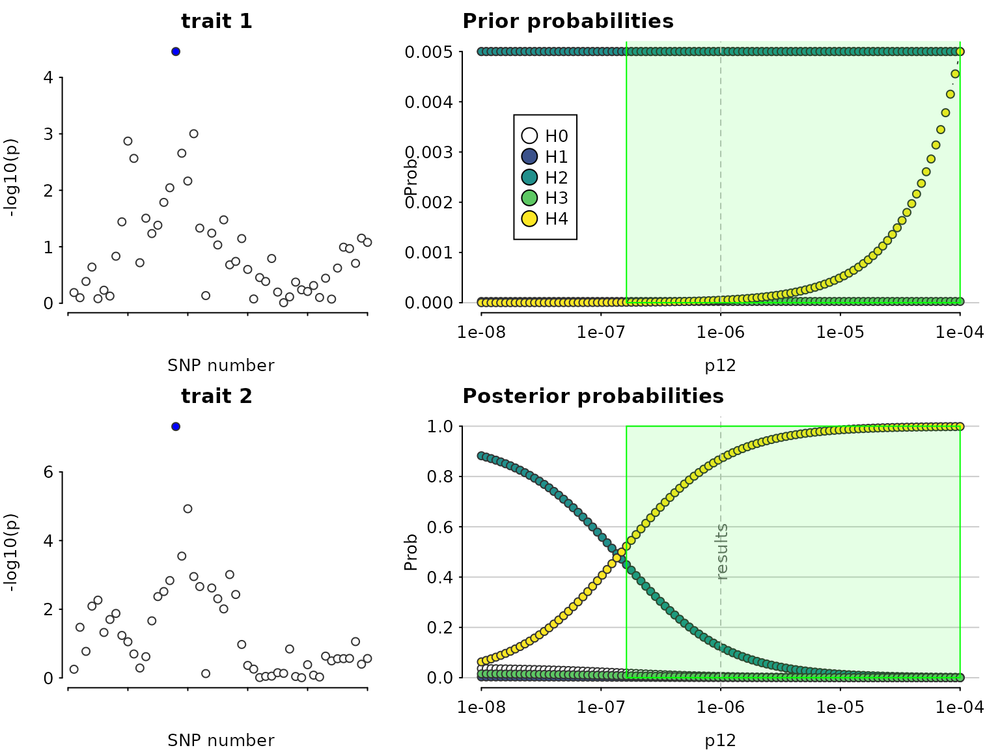
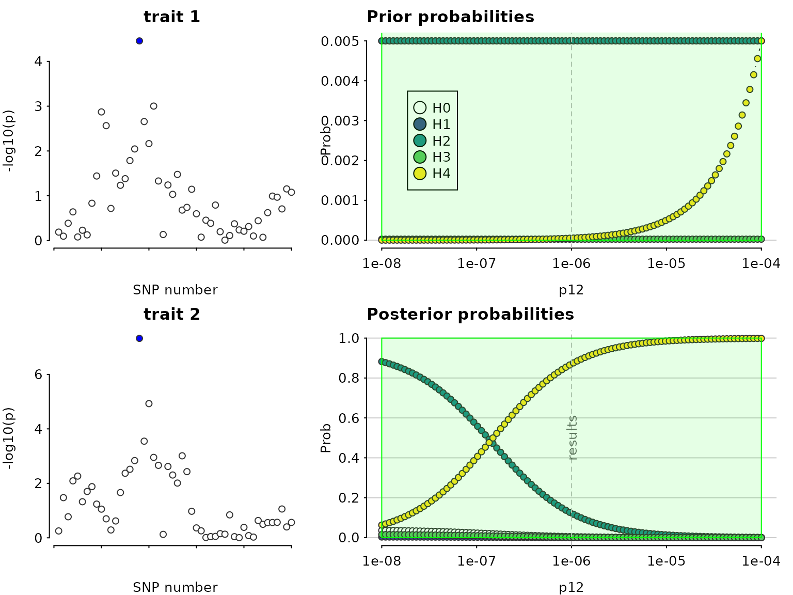

# Coloc: sensitivity to prior values

## Sensitivity analysis

Specifying prior values for coloc.abf() is important, as results can be
dependent on these values. Defaults of $`p_1=p_2=10^{-4}`$ seem
justified in a wide range of scenarios, because these broadly correspond
to a 99% belief that there is true association when we see
$`p<5\times 10^{-8}`$ in a GWAS. However, choice of $`p_{12}`$ is more
difficult. We hope the [coloc explorer
app](https://chr1swallace.shinyapps.io/coloc-priors/) will be helpful in
exploring what various choices mean, at a per-SNP and per-hypothesis
level. However, having conducted an enumeration-based coloc analysis, it
is still helpful to check that any inference about colocalisation is
robust to variations in prior values specified.

Continuing on from [the last
vignette](https://chr1swallace.github.io/coloc/articles/a03_enumeration.md),
we have

``` r

library(coloc)
```

    ## This is coloc version 7.0.2

``` r

data(coloc_test_data)
attach(coloc_test_data)
my.res <- coloc.abf(dataset1=D1,
                    dataset2=D2,
                    p12=1e-6)
```

    ## PP.H0.abf PP.H1.abf PP.H2.abf PP.H3.abf PP.H4.abf 
    ##  1.37e-17  2.92e-09  8.53e-11  8.28e-03  9.92e-01 
    ## [1] "PP abf for shared variant: 99.2%"

``` r

my.res
```

    ## Coloc analysis of trait 1, trait 2

    ## 
    ## SNP Priors

    ##    p1    p2   p12 
    ## 1e-04 1e-04 1e-06

    ## 
    ## Hypothesis Priors

    ##        H0   H1   H2       H3    H4
    ##  0.897005 0.05 0.05 0.002495 5e-04

    ## 
    ## Posterior

    ##        nsnps           H0           H1           H2           H3           H4 
    ## 5.000000e+02 1.366742e-17 2.915456e-09 8.529214e-11 8.276799e-03 9.917232e-01

A sensitivity analysis can be used, post-hoc, to determine the range of
prior probabilities for which a conclusion is still supported. The
sensitivity() function shows this for variable $`p_{12}`$ in the bottom
right plot, along with the prior probabilities of each hypothesis, which
may help decide whether a particular range of $`p_{12}`$ is valid. The
green region shows the region - the set of values of $`p_{12}`$ - for
which $`H_4 > 0.5`$ - the rule that was specified. In this case, the
conclusion of colocalisation looks quite robust. On the left
(optionally) the input data are also presented, with shading to indicate
the posterior probabilities that a SNP is causal if $`H_4`$ were true.
This can be useful to indicate serious discrepancies also.

``` r

sensitivity(my.res,rule="H4 > 0.5") 
```

    ## Results pass decision rule H4 > 0.5



Let’s fake a smaller dataset where that won’t be the case, by increasing
varbeta:

Now, colocalisation is very dependent on the value of $`p_{12}`$:

``` r

my.res <- coloc.abf(dataset1=D1a,
                    dataset2=D2a,
                    p12=1e-6)
```

    ## PP.H0.abf PP.H1.abf PP.H2.abf PP.H3.abf PP.H4.abf 
    ##  5.58e-07  1.61e-05  1.26e-03  2.67e-02  9.72e-01 
    ## [1] "PP abf for shared variant: 97.2%"

``` r

my.res
```

    ## Coloc analysis of trait 1, trait 2

    ## 
    ## SNP Priors

    ##    p1    p2   p12 
    ## 1e-04 1e-04 1e-06

    ## 
    ## Hypothesis Priors

    ##        H0   H1   H2       H3    H4
    ##  0.897005 0.05 0.05 0.002495 5e-04

    ## 
    ## Posterior

    ##        nsnps           H0           H1           H2           H3           H4 
    ## 5.000000e+02 5.583635e-07 1.612179e-05 1.261187e-03 2.669434e-02 9.720278e-01

``` r

sensitivity(my.res,rule="H4 > 0.5") 
```

    ## Results pass decision rule H4 > 0.5



In this case, we find there is evidence for colocalisation according to
a rule $`H_4>0.5`$ only for $`p_{12} > 10^{-6}`$, which corresponds to
an *a priori* belief that $`P(H_4) \simeq P(H_3)`$. This means but you
would need to think it reasonable that $`H_4`$ is equally likely as
$`H_3`$ to begin with to find these data convincing.

Note, the syntax can also consider more complicated rules:

``` r

sensitivity(my.res,rule="H4 > 3*H3 & H0 < 0.1") 
```

    ## Results pass decision rule H4 > 3*H3 & H0 < 0.1


