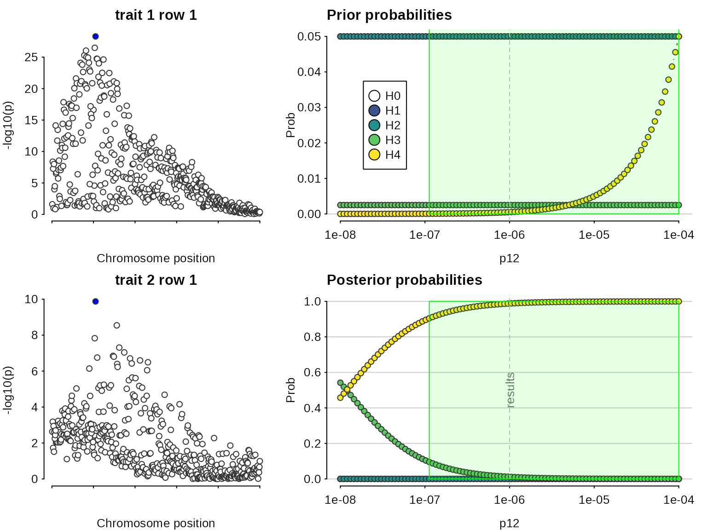
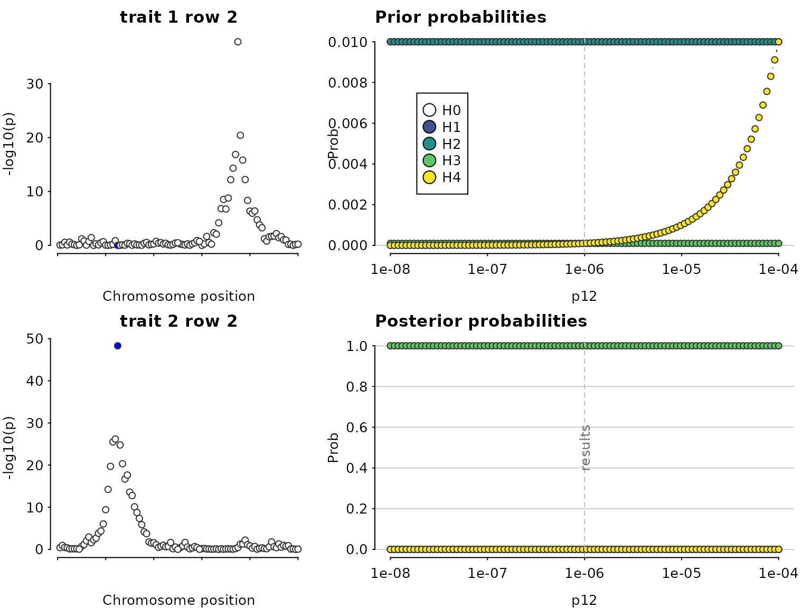

# DEPRECATED Coloc: relaxing the single causal variant assumption

## Multiple causal variants

*This describes deprecated functions - the [SuSiE
approach](https://chr1swallace.github.io/coloc/articles/a06_SuSiE.md) is
more accurate and should be used instead*

We load some simulated data.

``` r

library(coloc)
```

    ## This is coloc version 7.0.2

``` r

data(coloc_test_data)
attach(coloc_test_data) # contains D3, D4 that we will use in this vignette
```

First, let us do a standard coloc (single causal variant) analysis to
serve as a baseline comparison. The analysis concludes there is
colocalisation, because it “sees” the SNPs on the left which are
strongly associated with both traits. But it misses the SNPs on the
right of the top left plot which are associated with only one trait.

``` r

library(coloc)
my.res <- coloc.abf(dataset1=D3, dataset2=D4)
```

    ## PP.H0.abf PP.H1.abf PP.H2.abf PP.H3.abf PP.H4.abf 
    ##  8.78e-26  6.80e-07  1.53e-22  1.85e-04  1.00e+00 
    ## [1] "PP abf for shared variant: 100%"

``` r

class(my.res)
```

    ## [1] "coloc_abf" "list"

``` r

## print.coloc_abf
my.res
```

    ## Coloc analysis of trait 1, trait 2

    ## 
    ## SNP Priors

    ##    p1    p2   p12 
    ## 1e-04 1e-04 1e-05

    ## 
    ## Hypothesis Priors

    ##        H0   H1   H2       H3    H4
    ##  0.892505 0.05 0.05 0.002495 0.005

    ## 
    ## Posterior

    ##        nsnps           H0           H1           H2           H3           H4 
    ## 5.000000e+02 8.775708e-26 6.797736e-07 1.529399e-22 1.848705e-04 9.998144e-01

``` r

sensitivity(my.res,"H4 > 0.9")
```

    ## Results pass decision rule H4 > 0.9


Even though the sensitivity analysis itself looks good, the Manhattan
plots suggest we are violating the assumption of a single causal variant
per trait.\
We can use =finemap.signals= to test whether there are additional
signals after conditioning.

``` r

finemap.signals(D3,method="cond")
```

    ##      s105       s78 
    ## 11.180489  5.351394

``` r

finemap.signals(D4,method="cond")
```

    ##    s105 
    ## 6.42341

Note that every colocalisation conditions out every other signal except
one for each trait. For that reason, trying to colocalise many signals
per trait is not recommended. Instead, use pthr to set the significance
(p value) required to call a signal. If you set if too low, you will
capture signals that are non-significant, or too high and you will miss
true signals. pthr=5e-8 would correspond to a genome-wide significance
level for common variants in a European study, but we typically choose a
slightly relaxed pthr=1e-6 on the basis that if there is one
GW-significant signal in a region, we expect there is a greater chance
for secondary signals to exist.

``` r

finemap.signals(D3,method="cond",pthr=1e-20) ## too small
```

    ##     s105 
    ## 11.18049

``` r

finemap.signals(D4,method="cond",pthr=0.1) ## too big
```

    ##      s105      s108      s156 
    ##  6.423410 -3.226812  3.741284

Now we can ask coloc to consider these as separate signals using the
coloc.signals() function.

``` r

res <- coloc.signals(D3,D4,method="cond",p12=1e-6,pthr=1e-6)
```

    ## PP.H0.abf PP.H1.abf PP.H2.abf PP.H3.abf PP.H4.abf 
    ##  8.76e-25  6.79e-06  1.53e-21  1.85e-03  9.98e-01 
    ## [1] "PP abf for shared variant: 99.8%"
    ## PP.H0.abf PP.H1.abf PP.H2.abf PP.H3.abf PP.H4.abf 
    ##  1.83e-05  5.53e-04  3.19e-02  9.64e-01  3.52e-03 
    ## [1] "PP abf for shared variant: 0.352%"
    ## PP.H0.abf PP.H1.abf PP.H2.abf PP.H3.abf PP.H4.abf 
    ##  5.44e-04  2.33e-05  9.49e-01  4.04e-02  1.02e-02 
    ## [1] "PP abf for shared variant: 1.02%"

``` r

res
```

    ## Coloc analysis of trait 1, trait 2

    ## 
    ## SNP Priors

    ##    p1    p2   p12 
    ## 1e-04 1e-04 1e-06

    ## 
    ## Hypothesis Priors

    ##        H0   H1   H2       H3    H4
    ##  0.897005 0.05 0.05 0.002495 5e-04

    ## 
    ## Posterior

    ## Key: <hit2>
    ##    nsnps   hit1   hit2           H0           H1           H2         H3
    ##    <int> <char> <char>        <num>        <num>        <num>      <num>
    ## 1:   500   s105   s105 8.674493e-25 6.719334e-06 1.511759e-21 0.01171021
    ## 2:   500    s78   s105 1.830995e-05 5.531424e-04 3.190992e-02 0.96399665
    ##             H4
    ##          <num>
    ## 1: 0.988283067
    ## 2: 0.003521974

Note that because we are doing multiple colocalisations, sensitivity()
needs to know which to consider:

``` r

sensitivity(res,"H4 > 0.9",row=1)
```

    ## Results pass decision rule H4 > 0.9



``` r

sensitivity(res,"H4 > 0.9",row=2)
```

    ## Results fail decision rule H4 > 0.9


