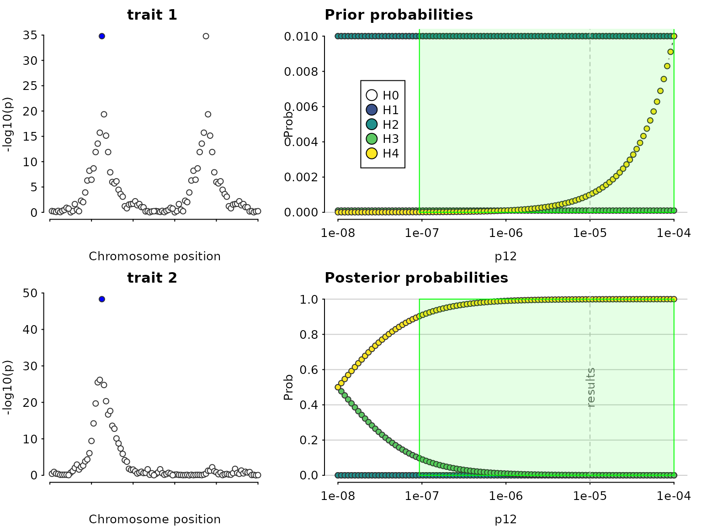
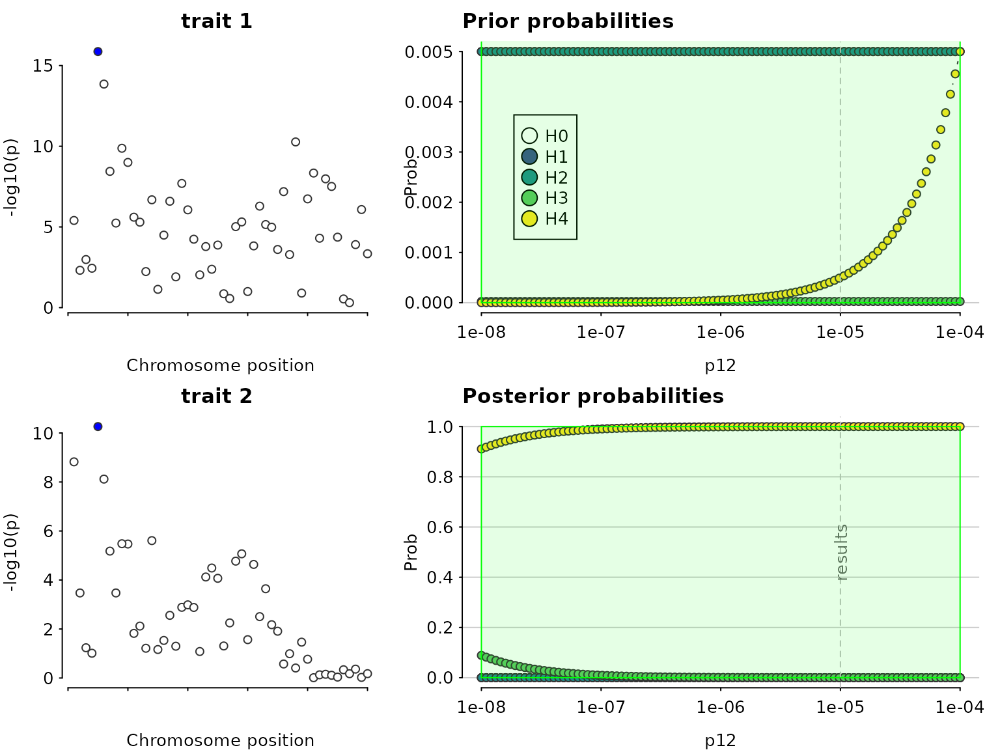
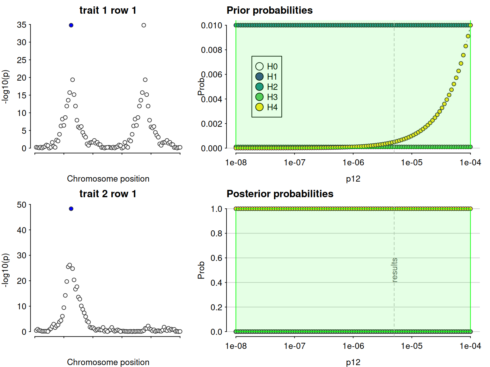
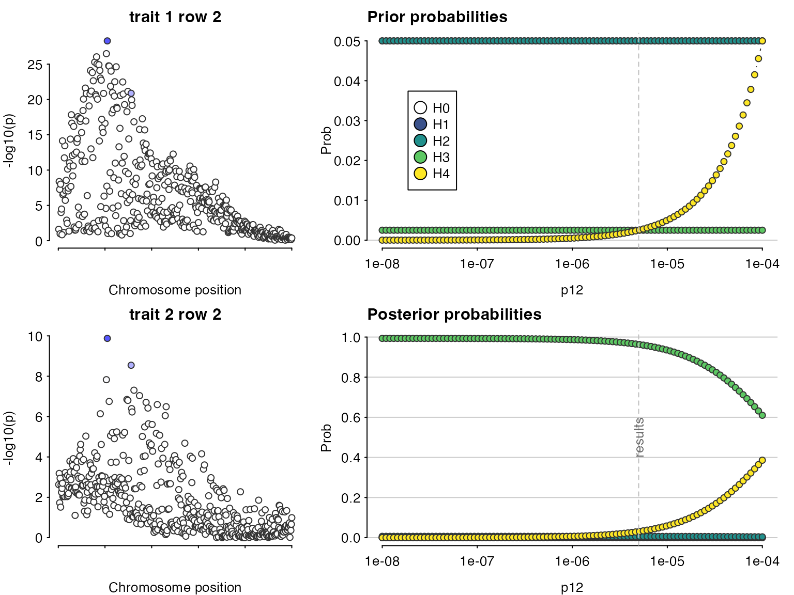

# Coloc: using SuSiE to relax the single causal variant assumption

## Multiple causal variants, using SuSiE to separate the signals

We load some simulated data.

``` r

library(coloc)
```

    ## This is coloc version 7.0.2

``` r

data(coloc_test_data)
attach(coloc_test_data) ## datasets D1, D2, D3 and D4
```

Datasets 3 and 4 are constructed to deliberately break the single causal
variant assumption in
[`coloc.abf()`](https://chr1swallace.github.io/coloc/reference/coloc.abf.md).

``` r

par(mfrow=c(2,1))
plot_dataset(D3, main="Dataset D3")
plot_dataset(D4, main="Dataset D4")
```



First, let us do a standard coloc (single causal variant) analysis to
serve as a baseline comparison. The analysis concludes there is
colocalisation, because it “sees” the SNPs on the left which are
strongly associated with both traits. But it misses the SNPs on the
right of the top left plot which are associated with only one trait.

``` r

my.res <- coloc.abf(dataset1=D3, dataset2=D4)
```

    ## PP.H0.abf PP.H1.abf PP.H2.abf PP.H3.abf PP.H4.abf 
    ##  8.78e-26  6.80e-07  1.53e-22  1.85e-04  1.00e+00 
    ## [1] "PP abf for shared variant: 100%"

``` r

class(my.res)
```

    ## [1] "coloc_abf" "list"

``` r

## print.coloc_abf
my.res
```

    ## Coloc analysis of trait 1, trait 2

    ## 
    ## SNP Priors

    ##    p1    p2   p12 
    ## 1e-04 1e-04 1e-05

    ## 
    ## Hypothesis Priors

    ##        H0   H1   H2       H3    H4
    ##  0.892505 0.05 0.05 0.002495 0.005

    ## 
    ## Posterior

    ##        nsnps           H0           H1           H2           H3           H4 
    ## 5.000000e+02 8.775708e-26 6.797736e-07 1.529399e-22 1.848705e-04 9.998144e-01

``` r

sensitivity(my.res,"H4 > 0.9")
```

    ## Results pass decision rule H4 > 0.9



Even though the sensitivity analysis itself looks good, the Manhattan
plots suggest we are violating the assumption of a single causal variant
per trait.

coloc has adopted the
[SuSiE](https://stephenslab.github.io/susie-paper/index.html) framework
for fine mapping in the presence of multiple causal variants. This
framework requires the LD matrix is known, so first check our datasets
hold an LD matrix of the right format. =check_dataset= should return
NULL if there are no problems, or print informative error messages if
there are.

``` r

check_dataset(D3,req="LD")
```

    ## NULL

``` r

check_dataset(D4,req="LD")
```

    ## NULL

SuSiE can take a while to run on larger datasets, so it is best to run
once per dataset with the =runsusie= function, store the results and
feed those into subsequent analyses. =runsusie= is just a wrapper around
the =susie_rss= function in the [susieR
package](https://stephenslab.github.io/susieR/) that automates running
until convergence and saves a little extra information about snp names
to make subsequent coloc processing simpler. Here, it does indeed find
two signals for dataset D3 (there are two rows in the credible sets
summary) and one for dataset D4.

``` r

if(requireNamespace("susieR",quietly=TRUE)) {
  S3=runsusie(D3)
  summary(S3)
  S4=runsusie(D4)
  summary(S4)
}
```

    ## running max iterations: 100

    ##  converged: TRUE

    ## running max iterations: 100

    ##  converged: TRUE

    ## 
    ## Variables in credible sets:
    ## 
    ##  variable variable_prob cs
    ##       105    0.90517152  1
    ##       156    0.06058201  1
    ## 
    ## Credible sets summary:
    ## 
    ##  cs cs_log10bf cs_avg_r2 cs_min_r2 variable
    ##   1   4.940385 0.5047112 0.5047112  105,156

With these susie output objects stored, we can colocalise every pair of
signals. This analysis says the first pair, tagged by s25.1 and s25 for
datasets D3 and D4, do not colocalise (posterior for H3 is close to 1),
whilst the second pair, tagged by the same SNP, s25, for both datasets,
do (posterior for H4 is close to 1).

``` r

if(requireNamespace("susieR",quietly=TRUE)) {
  susie.res=coloc.susie(S3,S4)
  print(susie.res$summary)
}
```

    ##    nsnps   hit1   hit2    PP.H0.abf    PP.H1.abf    PP.H2.abf    PP.H3.abf
    ##    <int> <char> <char>        <num>        <num>        <num>        <num>
    ## 1:   500   s105   s105 3.079008e-14 6.507291e-07 1.342030e-10 0.0008379729
    ## 2:   500    s89   s105 1.422896e-06 2.209787e-04 6.201896e-03 0.9631063070
    ##    PP.H4.abf  idx1  idx2
    ##        <num> <int> <int>
    ## 1: 0.9991614     1     1
    ## 2: 0.0304694     2     1

Note that because we are doing multiple colocalisations, sensitivity()
needs to know which to consider, and we need to give it the datasets
used if we want to see the Manhattan plots.

``` r

if(requireNamespace("susieR",quietly=TRUE)) {
  sensitivity(susie.res,"H4 > 0.9",row=1,dataset1=D3,dataset2=D4)
  sensitivity(susie.res,"H4 > 0.9",row=2,dataset1=D3,dataset2=D4)
}
```

    ## Results pass decision rule H4 > 0.9



    ## Results fail decision rule H4 > 0.9



## Important notes on running SuSiE

[`runsusie()`](https://chr1swallace.github.io/coloc/reference/runsusie.md)
is a wrapper around
[`susieR::susie_rss()`](https://rdrr.io/pkg/susieR/man/susie_rss.html).
It adds some colnames to the returned objects (so that snps can be
identified easily) and repeats the calls to `susie_rss()` until
convergence is achieved.

`susie_rss()` has many other options and you should look at them if
[`runsusie()`](https://chr1swallace.github.io/coloc/reference/runsusie.md)
is not giving the output you expect. They can be passed directly through
[`runsusie()`](https://chr1swallace.github.io/coloc/reference/runsusie.md).

``` r

if(requireNamespace("susieR",quietly=TRUE)) {
  ?susieR::susie_rss
}
```

One option I have varied to help SuSiE detect weaker signals, is the
coverage parameter. By default `susie_rss` looks for signals for which
it can form a 95% credible set. By reducing the coverage, we can find
weaker signals. For example we find nothing in this weaker signal
dataset

``` r

if(requireNamespace("susieR",quietly=TRUE)) {
  ## make a dataset with a weaker signal
  D5=D3
  D5$varbeta=D5$varbeta * 4
  D5$N=D5$N / 2
  par(mfrow=c(1,2))
  plot_dataset(D3, main="original D3")
  plot_dataset(D5, main="weaker signal D5")
  summary(runsusie(D5)) # default coverage 0.95
}
```

But by reducing the coverage we can find one signal

``` r

if(requireNamespace("susieR",quietly=TRUE)) {
  summary(runsusie(D5,coverage=0.1))  # lower coverage
}
```

These values are just for illustration, I probably wouldn’t believe a
signal in a real dataset with a $`p > 10^{-5}`$. They let you find
weaker signals, but the signals they find may not be real! coloc results
should be treated with caution. Nonetheless, this may be worthwhile if
you have a dataset with a weak signal which you know has replicated in
independent data.

``` r

if(requireNamespace("susieR",quietly=TRUE)) {
  S5=runsusie(D5,coverage=0.1)  # lower coverage
  summary(S5)
  res=coloc.susie(S5,S4)
  print(res$summary)
}
```
